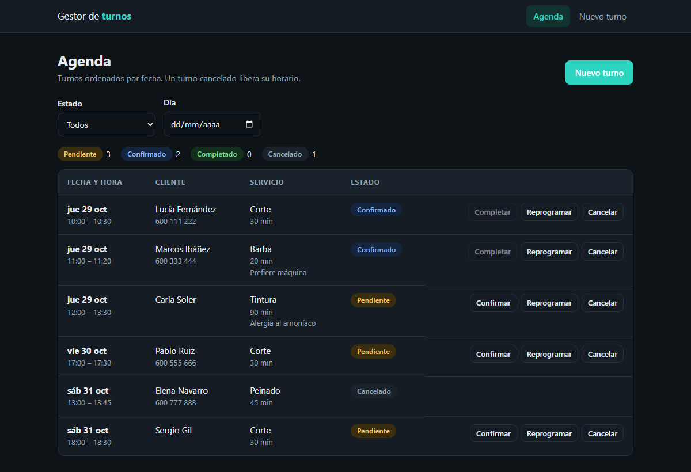
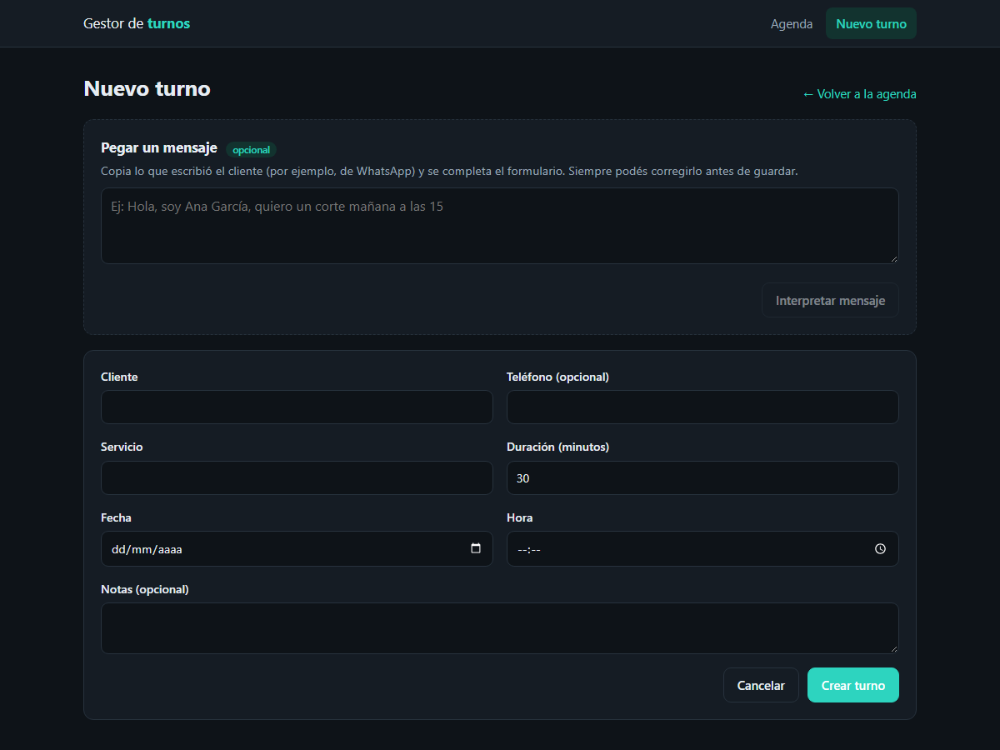
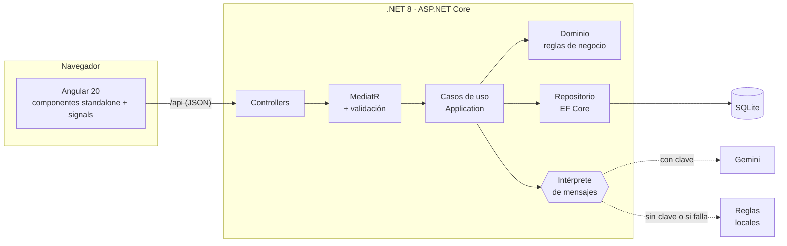

# Gestor de turnos — .NET 8 + Angular

[](https://github.com/fabrobona/turnos-dotnet-angular/actions/workflows/ci.yml)

Aplicación full-stack para gestionar la agenda de un negocio pequeño (peluquería, clínica, taller): turnos con estados, control de horarios que se pisan y un asistente que **lee un mensaje de WhatsApp y propone el turno**.

Es un proyecto de portfolio, pensado para mostrar cómo estructuro una API en .NET y un frontend en Angular: capas separadas, reglas de negocio en el dominio, errores uniformes, tests en todas las capas y todo listo para levantarse con un comando.



## Qué hace

- **Agenda** con filtros por estado y por día, y acciones según el estado de cada turno.
- **Ciclo de vida del turno:** `Pendiente → Confirmado → Completado`, con cancelación posible hasta que se completa.
- **No permite turnos que se pisen.** Un turno cancelado libera su horario; dos turnos contiguos (uno termina cuando empieza el otro) no cuentan como conflicto.
- **Reprogramar** cambia fecha, hora y duración, con la misma validación de conflictos.
- **Pegar un mensaje:** copiás lo que escribió el cliente ("Hola, soy Ana García, quiero un corte el viernes a las 4 de la tarde") y el formulario se completa solo. Siempre lo confirma una persona antes de guardar.



## Arquitectura



Cuatro proyectos con las dependencias apuntando hacia adentro (el dominio no conoce a nadie):

| Proyecto | Responsabilidad |
|---|---|
| `Turnos.Domain` | Entidad `Turno` con **todas** las reglas de negocio (estados, duración, fechas). Sin dependencias. |
| `Turnos.Application` | Casos de uso (comandos y consultas con MediatR), validaciones con FluentValidation, interfaces. |
| `Turnos.Infrastructure` | EF Core + SQLite, repositorio, migraciones, cliente de Gemini. |
| `Turnos.Api` | Controladores finos, manejo global de errores, CORS, rate limiting, Swagger. |

## Cómo ejecutarlo

### Con Docker (un comando)

```bash
docker compose up --build
```

Abrí <http://localhost:8080>. La API queda detrás de nginx y los datos persisten en un volumen.

### En local

Necesitás [.NET 8 SDK](https://dotnet.microsoft.com/download) y Node 22.

```bash
# Terminal 1: API (http://localhost:5080, Swagger en /swagger)
cd backend/src/Turnos.Api
dotnet run --launch-profile http

# Terminal 2: frontend (http://localhost:4200, proxy a la API)
cd frontend
npm install
npm start
```

En desarrollo la API carga unos turnos de ejemplo la primera vez.

### Interpretar mensajes con IA (opcional)

Sin configurar nada, los mensajes se interpretan con **reglas locales** (sirven para frases como "mañana a las 15", "el jueves a las 4 de la tarde" o "el 12/11 a las 10:30"). Con una clave de [Google AI Studio](https://aistudio.google.com/) se usa **Gemini**, que entiende mensajes más libres:

```bash
# local
dotnet user-secrets set "Gemini:ApiKey" "TU_CLAVE" --project backend/src/Turnos.Api

# docker: copiá .env.example como .env y completá GEMINI_API_KEY
```

La clave nunca va al repositorio (`.env` y los secretos están en `.gitignore`).

## API

Documentación interactiva en `/swagger`.

| Método | Ruta | Descripción |
|---|---|---|
| `GET` | `/api/turnos?desde=&hasta=&estado=` | Lista ordenada por fecha, con filtros opcionales |
| `GET` | `/api/turnos/{id}` | Un turno |
| `POST` | `/api/turnos` | Crea un turno (`201`; `409` si el horario está ocupado) |
| `PUT` | `/api/turnos/{id}/horario` | Reprograma fecha, hora y duración |
| `POST` | `/api/turnos/{id}/confirmar` | Pendiente → Confirmado |
| `POST` | `/api/turnos/{id}/completar` | Confirmado → Completado (solo si ya empezó) |
| `POST` | `/api/turnos/{id}/cancelar` | Pendiente o Confirmado → Cancelado |
| `POST` | `/api/turnos/interpretar-mensaje` | Propone los datos del turno a partir de un mensaje. **No crea nada.** |
| `GET` | `/health` | Estado del servicio |

**Errores uniformes** ([RFC 7807](https://datatracker.ietf.org/doc/html/rfc7807)): `400` datos inválidos (con el detalle por campo), `404` no existe, `409` conflicto de horario, `422` regla de negocio incumplida (por ejemplo, confirmar dos veces), `429` demasiadas solicitudes.

## Decisiones de diseño

- **Las reglas viven en el dominio.** `Turno.Confirmar()`, `Completar()` o `Reprogramar()` validan por sí mismos; los handlers y controladores no repiten reglas. Por eso se pueden probar sin base de datos ni HTTP.
- **Todo en UTC.** Se guarda y se transmite en UTC (con `Z`); la conversión a hora local solo ocurre en el navegador y al interpretar mensajes ("mañana a las 15" se resuelve en `Europe/Madrid`, configurable). SQLite no conserva la zona horaria, así que un convertidor de EF Core marca las fechas como UTC al leerlas.
- **`TimeProvider` en lugar de `DateTime.UtcNow`.** Permite probar "el turno ya empezó" o "el turno es en el pasado" con un reloj controlado.
- **La IA propone, una persona decide.** El endpoint de interpretación devuelve una sugerencia y nunca crea nada. La respuesta de Gemini se fuerza a un esquema JSON y además se **valida** (duración dentro de rango, textos recortados, fecha con formato exacto). El mensaje del cliente se trata como dato, no como instrucción, y el endpoint tiene límite de solicitudes por IP porque tiene costo.
- **Siempre hay respaldo.** Si Gemini falla, no hay clave o hay un timeout, se usa el intérprete por reglas y la aplicación sigue funcionando. No se registra el contenido del mensaje (puede tener datos personales).
- **MediatR 12 y FluentAssertions 6 a propósito:** las versiones siguientes de ambas pasaron a licencia comercial.
- **Frontend sin librería de UI:** componentes standalone, signals, formularios reactivos, rutas con carga diferida (302 kB iniciales, 85 kB comprimidos) y tema claro/oscuro según el sistema.

## Tests

```bash
# Backend: 65 unitarios + 17 de integración
cd backend && dotnet test

# Frontend: 39 tests (Karma + Jasmine, requiere Chrome)
cd frontend && npx ng test --watch=false --browsers=ChromeHeadless
```

- **Dominio y casos de uso** con un repositorio en memoria y reloj falso (sin base de datos).
- **Intérprete de mensajes:** frases reales en español, cambio de horario de Madrid, fechas imposibles, cliente HTTP simulado para Gemini, respaldo cuando falla.
- **Integración:** la API real con una base SQLite temporal por test (`WebApplicationFactory`): códigos HTTP, forma de los errores, fechas con `Z`, filtros, flujo completo de estados.
- **Frontend:** servicio HTTP (`HttpTestingController`), formularios, validaciones, errores del servidor y acciones de la agenda.

El CI de GitHub Actions corre todo esto y además construye las imágenes de Docker.

## Límites conocidos y siguientes pasos

Lo dejo escrito porque conviene saberlo antes de usarlo de verdad:

- **Sin autenticación.** Es una demo: cualquiera con acceso a la API puede operar. El siguiente paso sería JWT/OIDC y asociar cada turno a un negocio.
- **Carrera en los conflictos de horario.** La comprobación de solapes y el guardado no son atómicos: dos solicitudes simultáneas para el mismo horario podrían pasar ambas. En producción lo resolvería con una transacción serializable o una restricción de exclusión (por ejemplo en PostgreSQL, con `EXCLUDE USING gist` sobre el rango de tiempo).
- **SQLite** alcanza para una demo y un negocio chico; para varios nodos pasaría a PostgreSQL (el repositorio es la única capa que lo notaría).
- **Sin paginación** en el listado: se filtra por día o estado.
- **Un solo negocio y sin profesionales/recursos:** un turno bloquea toda la agenda. Modelar varios profesionales con su propio calendario es la extensión natural.

## Estructura

```
backend/
  src/Turnos.{Domain,Application,Infrastructure,Api}
  tests/Turnos.{UnitTests,IntegrationTests}
frontend/
  src/app/core        modelos, servicio HTTP, fechas, errores, avisos
  src/app/features    agenda y formulario de turnos
  src/app/shared      componentes reutilizables
docker-compose.yml    API + nginx con el frontend
```

## Licencia

[MIT](LICENSE)
